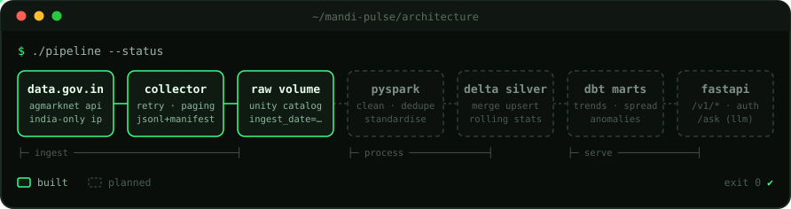

<p align="center">
  
</p>

<p align="center">
  
  
  
  
  
  
</p>

> [!NOTE]
> **Work in progress.** This project is being built step by step, so things will change.

## `❯ about`

**Price intelligence for Indian agricultural wholesale markets (mandis).**

Farmers and traders can't easily tell where a crop sells best today, how its price is trending,
or whether today's price is unusual. **mandi-pulse** collects daily mandi prices from India's
open-data API, cleans them up, and serves trends, anomalies and best-market comparisons through a REST API.

## `❯ features`

- **Collect daily prices** from the [data.gov.in](https://data.gov.in) AGMARKNET API and build its own history
  (the source only shows today's prices).
- **Clean messy data**: different spellings of the same market or commodity, mixed units, invalid price ranges.
- **Analyse prices**: trends, rolling averages, unusual-price (anomaly) detection, and the best market within X km.
- **Serve it through a public API** (FastAPI) with docs, auth and rate limiting.
- **Answer plain-English questions** (`/ask`), with an LLM picking which API endpoint to call.

## `❯ architecture`

<p align="center">
  
</p>

| Layer | Local | Cloud |
|---|---|---|
| Ingestion | `python` + `requests` | scheduled runner with an Indian IP → Databricks Volume |
| Processing | `pyspark` + `delta-spark` | Databricks Jobs |
| Transform | `dbt-duckdb` | `dbt-databricks` + SQL warehouse |
| API | `fastapi` | Databricks Apps |
| Infra | — | Terraform + Databricks Asset Bundles |

## `❯ roadmap`

```console
$ mandi-pulse --roadmap
[✔] phase 0  setup              python 3.12 · java 17 · local spark + delta
[~] phase 1  daily collector    client ✔  writer ✔  upload ✔  schedule …  tests …
[ ] phase 2  pyspark            bronze → silver → features
[ ] phase 3  dbt                incremental models · snapshots · tests
[ ] phase 4  fastapi            prices · trends · arbitrage · anomalies
[ ] phase 5  llm /ask           function calling over the api
[ ] phase 6  ship               databricks · ci/cd · terraform
```

## `❯ data`

- **Current Daily Price of Various Commodities from Various Markets (Mandi)**, data.gov.in (from AGMARKNET)
- **Variety-wise Daily Market Prices Data of Commodity**, data.gov.in (historical, since 2010)

Notes on how the API behaves and its quirks are in [`docs/source_notes.md`](docs/source_notes.md).

> [!WARNING]
> **data.gov.in blocks requests from outside India.** GitHub-hosted runners and Databricks Free Edition
> can't reach it, so the collector currently runs by hand from a machine in India. An automated schedule
> (GitHub Actions through an India-based SSH tunnel) is in progress.

## `❯ run locally`

Requires Python 3.12 and Java 17 (for PySpark).

```bash
python3 -m venv .venv && source .venv/bin/activate
pip install -r requirements.txt

# .env (never committed)
#   DATA_GOV_API_KEY=...        free key from data.gov.in
#   DATABRICKS_HOST=...         only needed for the upload step
#   DATABRICKS_TOKEN=...
```

Daily collection (run from the project root, from an Indian IP):

```bash
python -m ingestion.collect_daily                  # -> data/raw/agmarknet/ingest_date=<IST date>/
python -m ingestion.collect_daily --max-pages 1    # quick test run (not uploaded)
python -m ingestion.upload_to_volume               # -> Databricks Volume
```

---

<p align="center"><sub><code>❯ built by <a href="https://github.com/Vijayrajdev">vijay</a> · a learning + portfolio project</code></sub></p>
